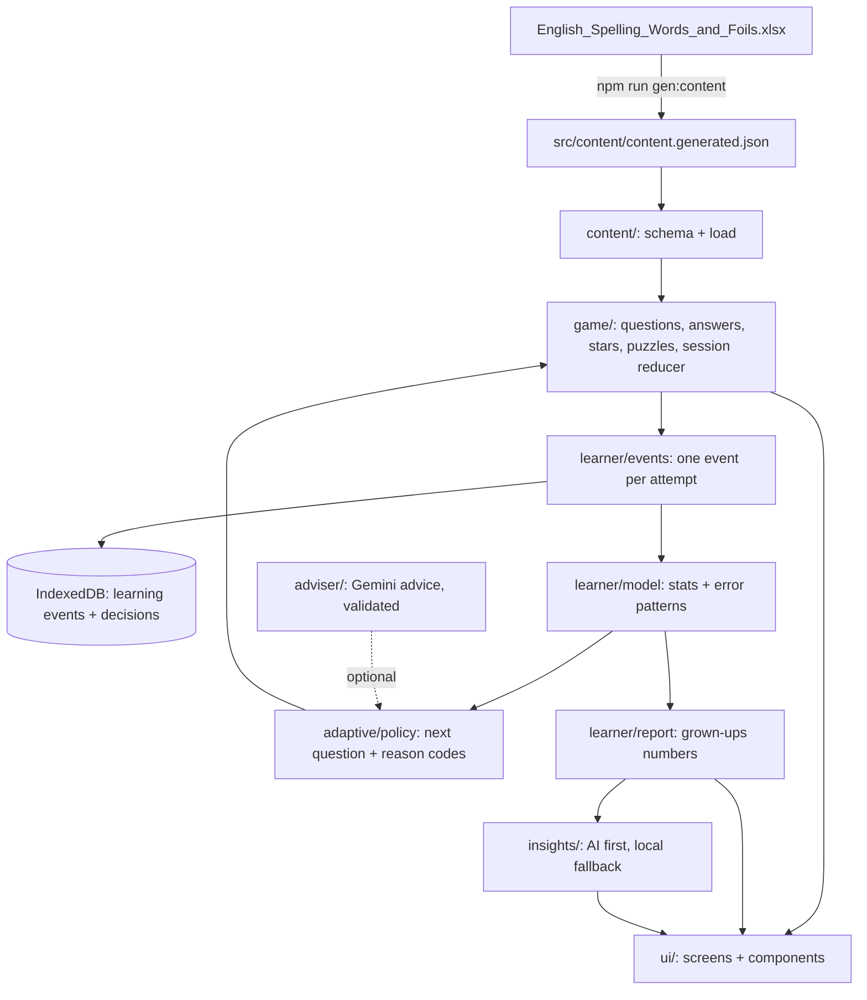
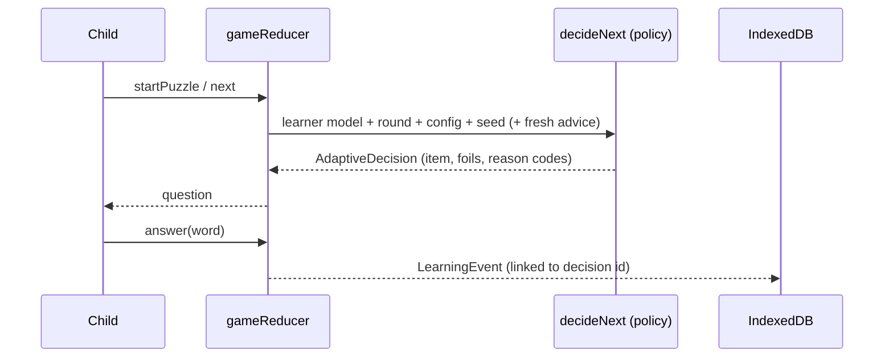

# Architecture

A React 19 + TypeScript (strict) single-page app, built with Vite and installable as a PWA. Two Cloudflare Pages Functions serve the optional AI features. Everything a child needs to play runs on the device.

## Layers

## Folders

| Folder | Responsibility | Notes |
|---|---|---|
| `src/content/` | Schema, import normalisation, validation, runtime loading | The only code that knows the spreadsheet layout is `normalize.ts` |
| `src/game/` | Question building, answer state, stars, puzzles, the screen-flow reducer (`session.ts`), hints, seeded RNG | Pure; randomness, time and ids arrive in actions |
| `src/learner/` | Learning events, the learner model, the grown-ups report | Pure functions of events |
| `src/adaptive/` | Policy, presentation rules, reason codes, provisional config, decision schema | Deterministic for the same inputs and seed |
| `src/adviser/` | Gemini advice for play: request builder, validation, browser client, server handler, shared Gemini caller | Optional; never on the child's path |
| `src/insights/` | Grown-ups' suggestions: request, safety validation, local fallback, client, server | Optional; AI first with a local fallback |
| `src/persistence/` | Progress (localStorage), preferences (localStorage), events and decisions (IndexedDB v2) | Validated reads; failures never block play |
| `src/audio/` | Word audio (bundled MP3, then speech, then notice) and synthesized UI sounds | Behind small interfaces |
| `src/pwa/` | Service worker registration and an update/status store | Updates apply only on the Welcome and level screens |
| `src/platform/` | Android container bridge (`window.Android`) | Capability-detected |
| `src/ui/` | Screens, cartoon components, press feedback, theme | Views only; rules live elsewhere |
| `functions/api/` | `advice.ts` and `insights.ts` Pages Functions | Thin wrappers over `src/adviser/server.ts` and `src/insights/server.ts` |
| `scripts/` | Content import, icon generation, Gemini model listing, fake Gemini, sample requests | Run with Node 24 (native TypeScript) |

## State and flow

`App.tsx` holds one `GameState` and runs every action through the pure `gameReducer`. That state is:

- `screen`
- `progress`
- `events`
- `decisions`
- `advice`

The app adds side effects around the reducer, but the reducer never depends on them:

- **Saving:** progress goes to localStorage; new events and decisions go to IndexedDB.
- **Sound:** the word plays from the tap that opens a question, which browsers require for audio. Sound effects play on presses and outcomes.
- **Background advice:** a request is made on the puzzle map, and the result arrives as an `adviceReceived` action.
- **Updates:** a waiting update is applied only when it is safe.

## Key design decisions

- **Puzzles keep curriculum order.** Each puzzle's 5 new words are asked in order. The policy may add up to 3 extras, and extras never cost stars.
- **Same answer size for every tile.** One text size per question, set by the longest word. A smaller word would hint that it has extra letters.
- **Long words stack.** On narrow phones, words of 8 or more letters stack one tile per row so they stay large. Words never wrap.
- **Press feedback without `:active`.** Elements with `data-press` get `data-pressed` from pointer-down for at least 140 ms. Screen-changing buttons wait 120 ms so the squish is visible.
- **AI can only narrow choices.** Advice picks among candidates the policy already made eligible. It cannot add, reorder curriculum, score, or change answers.
